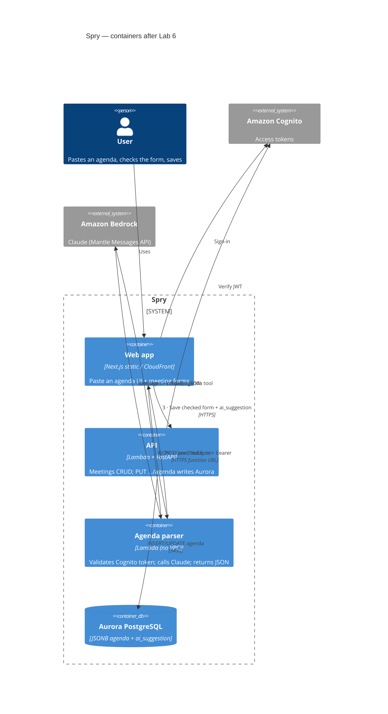

# C4 container diagram (Lab 6) — Paste an agenda

Update of the Lab 1 container view: parser Lambda, Bedrock, and the two arrows
**parse** (browser → parser → Bedrock) and **save** (browser → API → Aurora).

## Flow

1. **Parse** — Browser → agenda-parser Lambda (outside VPC) → Bedrock Claude → JSON.
2. **Review** — Pre-filled form with “suggested” badges; user may edit.
3. **Save** — Browser → API Lambda → Aurora. The model never writes.
